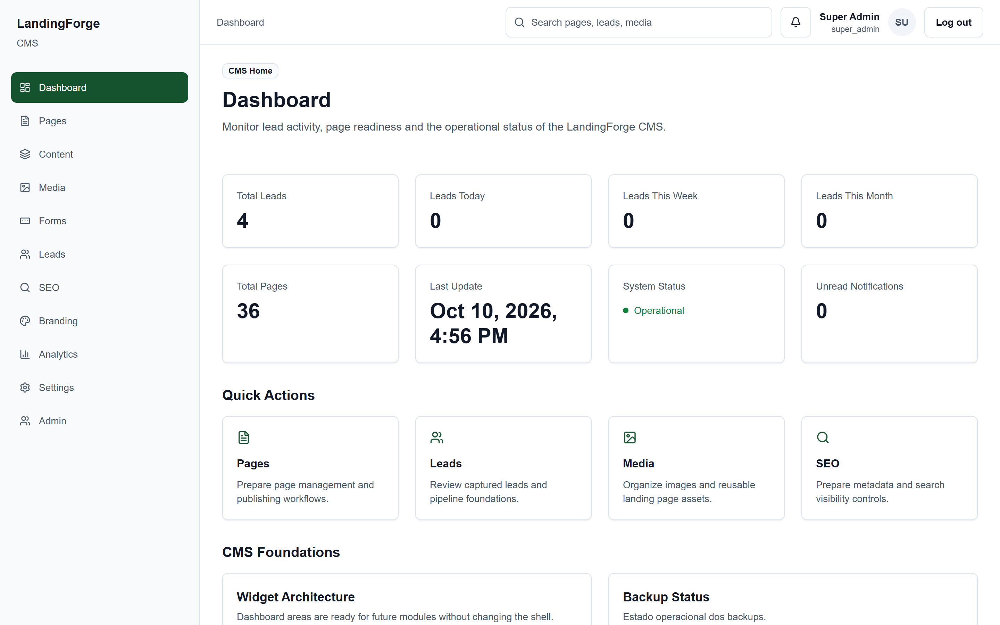
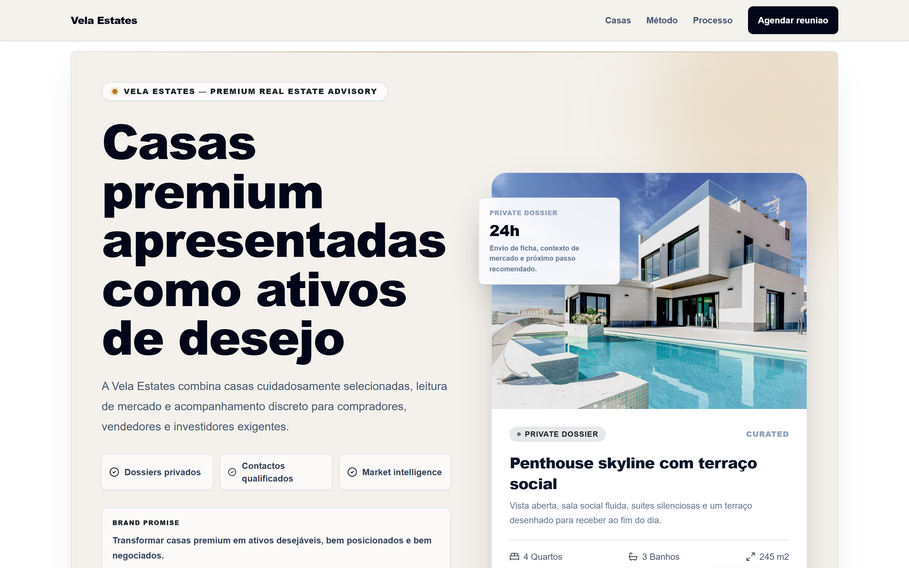
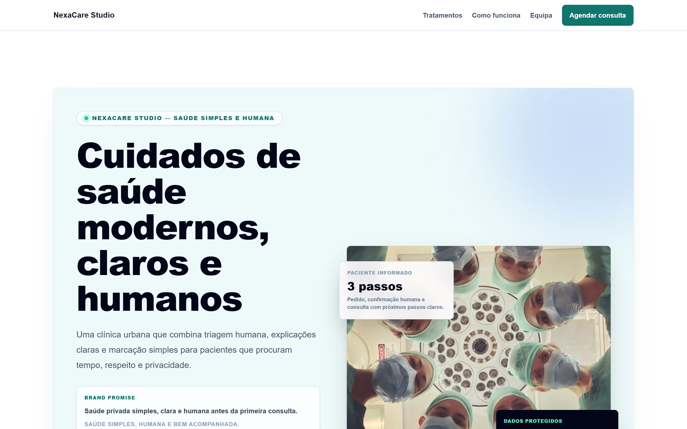
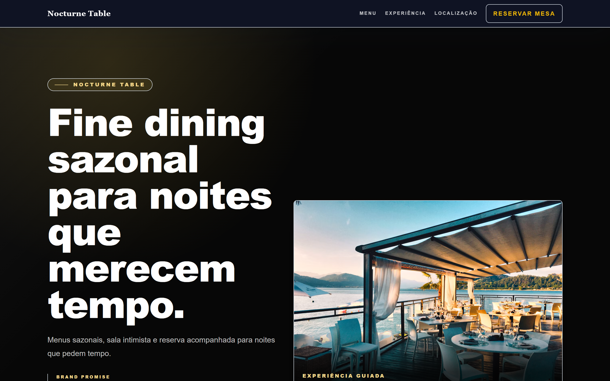
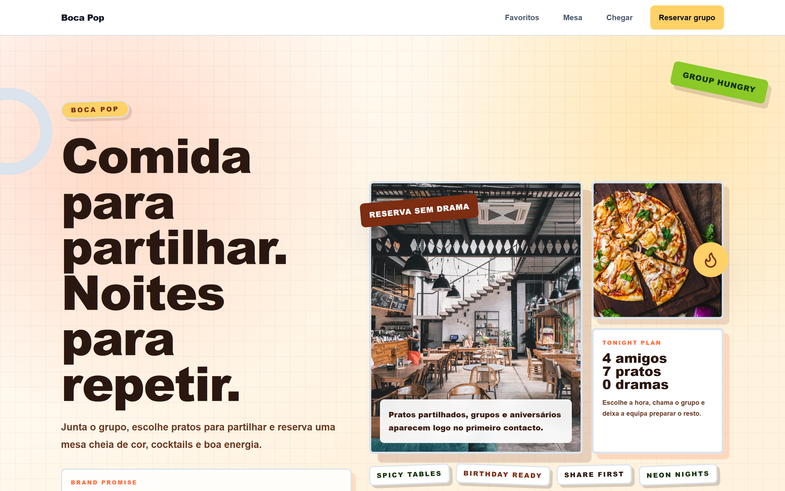
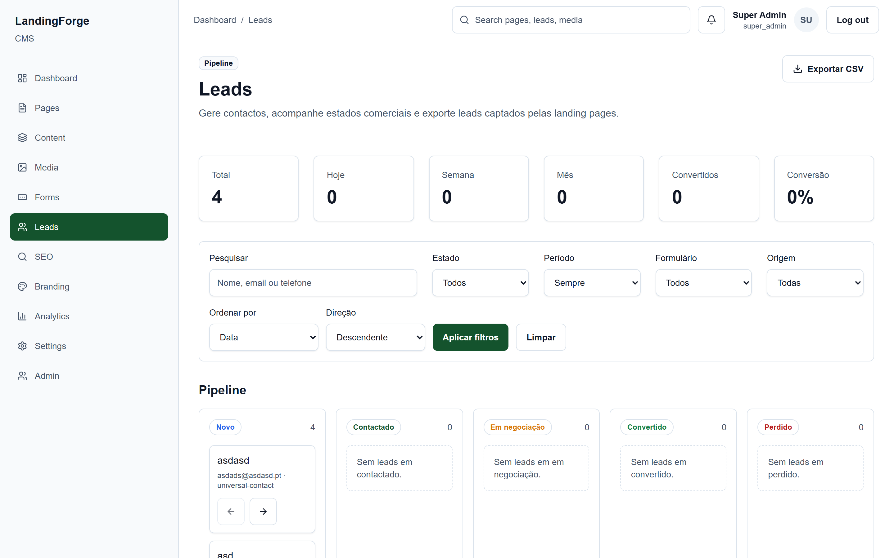

<div align="center">

# 🔥 LandingForge

### Premium Landing Page Platform

**Create, manage and deploy high-converting landing pages — fast.**

[](https://nextjs.org/)
[](https://www.typescriptlang.org/)
[](https://tailwindcss.com/)
[](https://www.prisma.io/)
[](https://www.postgresql.org/)

<br />

[Features](#-features) · [Templates](#-template-system) · [CMS & Pipeline](#-focused-cms--lead-pipeline) · [Architecture](#-architecture) · [Tech Stack](#-tech-stack) · [Getting Started](#-getting-started) · [Roadmap](#-roadmap)

<br /><br />



</div>

<br />

---

## 🚧 Development Status

> **Active Development** — This project is under active development and is not yet feature-complete.

The full-stack platform (CMS, authentication, forms, leads, SEO, branding, media, email, monitoring) is fully implemented. The current focus is on expanding industry-specific templates.

| Phase | Description | Status |
|---|---|---|
| Phase 1 | Platform & CMS Foundation (23 tasks) | ✅ Complete |
| Phase 2 | Industry Research & Specification (7 industries) | ✅ Complete |
| Phase 3 | Template Implementation | 🔄 In Progress (3 of 7 industries) |

---

## 💡 The Problem

Agencies, freelancers and businesses that deliver landing pages for clients face the same challenge every time: **rebuilding the same foundations from scratch** — layout systems, form handling, SEO setup, CMS, lead capture, branding, responsive design.

**LandingForge solves this** by providing a complete platform purpose-built for landing pages, with reusable industry-specific templates, a focused CMS, and a production-ready architecture.

> **This is not a generic website builder.** LandingForge is intentionally focused on landing pages that need to look premium, load fast, and convert visitors into leads.

---

## ✨ Features

<table>
<tr>
<td width="50%">

### 🎨 Public Renderer
Modular rendering engine that converts CMS content into polished, responsive landing pages with template-specific layouts, configurable presentation patterns, theme-aware styling and structured data.

### 📋 Focused CMS
Purpose-built content management for landing pages — pages, sections, media, forms, leads, SEO, branding and analytics. No bloat.

### 🏗️ Template System
Industry-specific templates organized by vertical and visual positioning. Each template can use its own brand-led header, footer, FAQ/contact presentation and restrained motion while keeping page content CMS-editable.

### 📊 Lead Management
Full lead capture pipeline — form submissions, lead dashboard, export workflows, consent tracking and audit logging.

</td>
<td width="50%">

### 🔍 SEO Engine
Technical SEO foundations including metadata management, structured data, semantic HTML and search engine optimization controls.

### 🎭 Branding & Themes
Per-client branding configuration with theme engine, color schemes, typography and visual identity controls.

### 🔒 Security First
Auth.js authentication, role-based access control, Zod validation, rate limiting, Cloudflare Turnstile, honeypot protection and input sanitization.

### 📧 Email System
Transactional email delivery with Resend, lead notifications, digest scheduling and delivery tracking.

</td>
</tr>
</table>

**Additional capabilities:**

- ⚡ Performance-first architecture (Lighthouse > 90 target)
- ♿ Accessibility-aware implementation
- 🎞️ Lightweight, template-specific motion with reduced-motion support
- 📱 Mobile-first responsive design
- 🖼️ Media management with Supabase Storage
- 🛡️ Monitoring & error tracking with Sentry
- 👥 Role-based CMS access (Super Admin, Client Admin, Viewer)
- 🌱 Fictional demo seed data for local development

---

## 🏠 Template System

Templates are organized by **industry** and **visual positioning**. Each industry supports multiple variants optimized for different market segments.

| Industry | Variants | Status |
|---|---|---|
| 🏠 Real Estate | Local Agency · Premium | ✅ Implemented |
| 🏥 Clinic | Modern · Luxury | ✅ Implemented |
| 🍽️ Restaurant | Fine Dining · Playful | ✅ Implemented |
| 🧁 Bakery | Playful | ✅ Implemented |
| 💪 Gym | Modern | ✅ Implemented |
| 🏗️ Construction | — | 🔜 Planned |
| 💄 Beauty | — | 🔜 Planned |

Each template includes:
- Reusable section definitions and industry-specific content structure
- A distinct visual direction, with tailored public header/footer and section presentation where implemented
- Theme and branding presets, plus fictional demo content for preview
- Responsive layouts and lightweight motion designed to respect reduced-motion preferences

### 🖼️ Template Previews

<table>
  <tr>
    <td width="50%">
      <p align="center"><b>🏠 Real Estate — Premium Variant (Vela Estates)</b></p>
      
    </td>
    <td width="50%">
      <p align="center"><b>🏥 Clinic & Healthcare — Modern Variant (NexaCare Studio)</b></p>
      
    </td>
  </tr>
  <tr>
    <td width="50%">
      <p align="center"><b>🍷 Restaurant — Fine Dining Variant (Nocturne Table)</b></p>
      
    </td>
    <td width="50%">
      <p align="center"><b>🍕 Restaurant — Playful Variant (Boca Pop)</b></p>
      
    </td>
  </tr>
</table>

---

## 📊 Focused CMS & Lead Pipeline

LandingForge includes an internal content management system and lead pipeline tailored specifically for landing pages — keeping lead conversion, status tracking, and GDPR consent at the center.

<br />



<br />

- **Kanban Lead Flow:** Visual pipeline with automatic stage transitions (*Novo* → *Contactado* → *Em negociação* → *Convertido* → *Perdido*).
- **One-Click Export:** Instant CSV export with consent timestamps and source tracking.
- **Granular Filters:** Filter by period, origin form, landing page, and status.
- **Audit & Security:** Role-based access control, rate limiting, Turnstile anti-spam, and audit log entries for every lead interaction.

---

## 🏗 Architecture

LandingForge follows a modular, feature-based architecture with clear separation between public rendering, CMS management, domain services and persistence.

```
src/
├── app/                    → Next.js App Router (routes & layouts)
├── components/             → Shared UI components (shadcn/ui based)
├── features/               → Domain modules
│   ├── public-renderer/    → Public landing page rendering engine
│   ├── cms/                → CMS shell & dashboard
│   ├── content/            → Content & section management
│   ├── forms/              → Form engine & validation
│   ├── leads/              → Lead capture & management
│   ├── seo/                → SEO metadata management
│   ├── branding/           → Theme & brand configuration
│   ├── media/              → Media management
│   ├── email/              → Email delivery & digests
│   ├── monitoring/         → Error tracking & system logs
│   └── settings/           → App & notification settings
├── services/               → Shared service layer
├── lib/                    → Shared infrastructure & utilities
├── config/                 → Application configuration
├── hooks/                  → Custom React hooks
└── types/                  → Shared TypeScript types

prisma/
├── schema.prisma           → Database schema
├── migrations/             → Database migrations
└── seeds/                  → Fictional demo data

public-docs/                → Curated public documentation
tests/                      → Automated test suite
```

### Data Flow

```
CMS Input → Zod Validation → Server Action / Route Handler → Service Layer → Prisma → PostgreSQL
                                                                                         ↓
                                                              Public Renderer ← Template Registry
```

---

## 🛠 Tech Stack

<table>
<tr><td><b>Category</b></td><td><b>Technology</b></td></tr>
<tr><td>Framework</td><td>Next.js 16 (App Router)</td></tr>
<tr><td>Language</td><td>TypeScript 6</td></tr>
<tr><td>Styling</td><td>Tailwind CSS 4</td></tr>
<tr><td>UI Components</td><td>shadcn/ui</td></tr>
<tr><td>Animations</td><td>Framer Motion</td></tr>
<tr><td>Database</td><td>PostgreSQL + Prisma ORM</td></tr>
<tr><td>Authentication</td><td>Auth.js (NextAuth v5)</td></tr>
<tr><td>Storage</td><td>Supabase Storage</td></tr>
<tr><td>Forms</td><td>React Hook Form + Zod</td></tr>
<tr><td>Email</td><td>Resend</td></tr>
<tr><td>Anti-Spam</td><td>Cloudflare Turnstile + Honeypot</td></tr>
<tr><td>Monitoring</td><td>Sentry</td></tr>
<tr><td>Testing</td><td>Vitest</td></tr>
<tr><td>Linting</td><td>ESLint + Prettier</td></tr>
<tr><td>Hosting</td><td>Vercel</td></tr>
</table>

---

## 🚀 Getting Started

### Prerequisites

- Node.js (LTS)
- PostgreSQL
- npm

### Installation

```bash
# Clone the repository
git clone https://github.com/pacheco4480/landingforge.git
cd landingforge

# Install dependencies
npm install

# Copy environment variables
cp .env.example .env.local

# Configure DATABASE_URL and DIRECT_URL in .env.local
```

### Database Setup

```bash
# Generate Prisma client
npm run db:generate

# Run migrations
npm run db:migrate

# Seed demo data (fictional brands and content)
npm run db:seed
```

### Development Server

```bash
npm run dev
```

Open [http://localhost:3000](http://localhost:3000)

### Quality Checks

```bash
npm run lint          # ESLint
npm run typecheck     # TypeScript validation
npm run build         # Production build
npm run test          # Vitest test suite
npx prisma validate   # Schema validation
```

---

## 📖 Documentation

Curated public documentation is available in [`public-docs/`](./public-docs/):

| Document | Description |
|---|---|
| [Architecture Overview](./public-docs/ARCHITECTURE.md) | System architecture, layers and design principles |
| [CMS Overview](./public-docs/CMS_OVERVIEW.md) | CMS scope, features and content management approach |
| [Template System](./public-docs/TEMPLATE_SYSTEM.md) | Template architecture, industry foundations and sections |
| [Security & Privacy](./public-docs/SECURITY_AND_PRIVACY.md) | Security practices, authentication and data handling |
| [Local Setup](./public-docs/LOCAL_SETUP.md) | Detailed local development setup instructions |
| [Public Roadmap](./public-docs/ROADMAP.md) | Product direction and planned features |

---

## 🗺️ Roadmap

**Platform Foundation** ✅
- [x] Next.js App Router foundation with TypeScript
- [x] Prisma/PostgreSQL data model & migrations
- [x] Authentication (Auth.js) & role-based access control
- [x] Design system & reusable UI component library
- [x] CMS shell with dashboard & navigation
- [x] Content & section management
- [x] Branding, theme engine & media library
- [x] SEO engine & structured data
- [x] Forms engine with validation
- [x] Lead capture, pipeline & management
- [x] Email notifications & digest system
- [x] Anti-spam, Turnstile & rate limiting
- [x] Public landing page renderer
- [x] GDPR, legal pages & cookie consent
- [x] Audit logs, backups & export
- [x] Error tracking & monitoring (Sentry)
- [x] Performance & accessibility review
- [x] MVP audit & QA

**Industry Templates** 🔄 (5 of 7 Industries Started)
- [x] Real Estate — Local Agency · Premium
- [x] Clinic & Healthcare — Modern · Luxury
- [x] Restaurant — Fine Dining · Playful
- [x] Bakery — Playful (Warm variant planned)
- [x] Gym & Fitness — Modern (Performance variant planned)
- [ ] Construction — Reliable · Premium
- [ ] Beauty & Wellness — Elegant · Playful

**Commercial & Agency Operations** 🔜 (Phase 4)
- [ ] **Public Portfolio Showcase:** Interactive template browser with industry filters, live preview switcher and conversion goals
- [ ] **Client Provisioning & Standalone Export:** Automated packaging engine to deploy isolated landing page bundles for client handoff
- [ ] **Smart Briefing & Client Hub:** Centralized workspace replacing spreadsheets with client assets, structured requirements, and AI context prompts
- [ ] **Client Handover & Delivery Kits:** White-label documentation, client manuals, and automated DNS/domain setup checklists
- [ ] **Behance & Marketing Showcase:** Case studies, creative direction boards, and high-impact presentation assets

---

## 📝 Environment Variables

Use [`.env.example`](./.env.example) as the public reference.

**Never commit** real API keys, database passwords, service role keys, or private tokens.

---

## 📄 License

All rights reserved. A license will be selected in a future release.

---

<div align="center">

**Built with precision and a focus on quality.**

</div>
